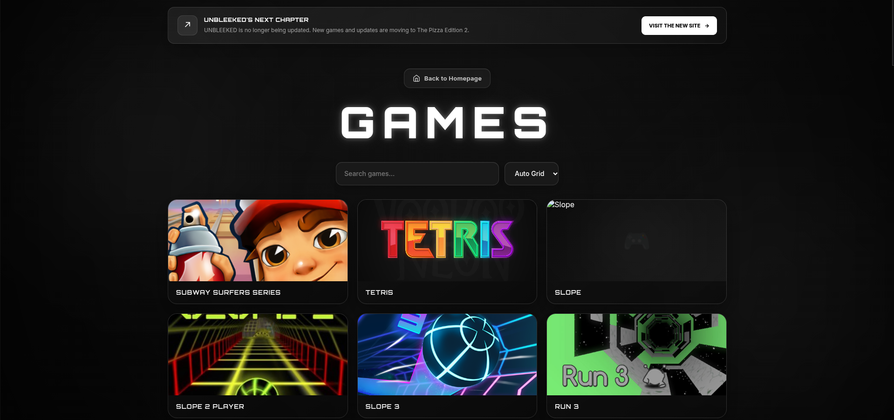

# 🎮 UNBLEEKED

A browser game hub with a growing library of games, a few built-in web apps, and customizable privacy-style features like tab cloaking and panic keys. Runs entirely in the browser with no downloads.

**▶ Live site:** `https://unbleeked.vercel.app` & `https://unbleeked2.netlify.app`


<!-- TODO: add a screenshot of the home page at images/screenshot.png -->

> ## ✅ Project status: Complete
> UNBLEEKED is **finished and no longer receiving updates**. The final commit has been made. Development has moved to **[THE PIZZA EDITION 2](https://github.com/LEBRONGOAT2323/THE-PIZZA-EDITION-2)**, which is the actively maintained successor.

---

## Features

### 🎮 Games
- A library of browser games that start instantly
- Catalog driven by `games.json`
- Works on Chromebooks, laptops, tablets, and phones

### 🛠️ Apps and extra pages
- **AI Humanizer** – a tool for rewriting AI-generated text
- **Movies** page
- **FAQ** page

### ⚙️ Customization
- **Tab cloaking** – change how the browser tab appears
- **Custom panic keys** – set your own shortcut
- **Custom locations** – choose where the panic key sends you
- Animated, minimal interface designed to load fast


**Run it Locally:**

```bash
git clone https://github.com/LEBRONGOAT2323/unbleeked.git
cd unbleeked

python3 -m http.server 8000   # or: npx serve
```

Then open `http://localhost:8000`.

## Tech stack

- HTML, CSS, and vanilla JavaScript
- JSON for the game catalog
- Vercel and Netlify for hosting

## How it works

The site is a static, multi-page project with no build step.

| Path | Purpose |
|---|---|
| `index.html` | Home page |
| `games.json` | Game catalog |
| `g.html`, `a.html`, `e.html` | Games, apps, and extras pages |
| `ai-humanizer.html` | AI Humanizer tool |
| `movies.html` | Movies page |
| `faq.html` | FAQ |
| `404.html` | Custom not-found page |
| `g/`, `a/` | Game and app files |
| `images/` | Images |


## What I learned

*  JSON is the most reliable way of loading games fast and professionally.
*  Rectangular game cards do not work well.
*  Having more pages doesn't always mean better.

## Credits and game ownership

Games remain the property of their original creators. This project is for educational and personal use. If you are a creator and want a game removed, please open an issue.

## License

MIT License © 2026 LEBRONGOAT2323. See [LICENSE](LICENSE).
The name **UNBLEEKED** and its branding may not be used without permission.
